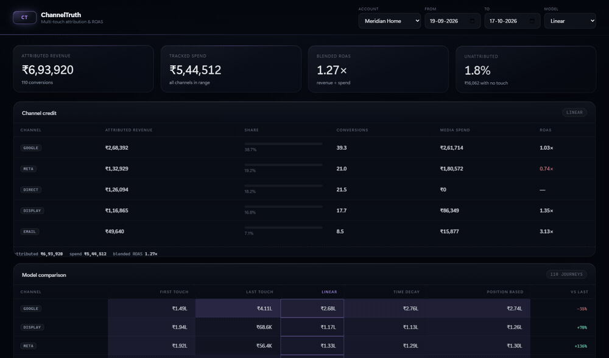
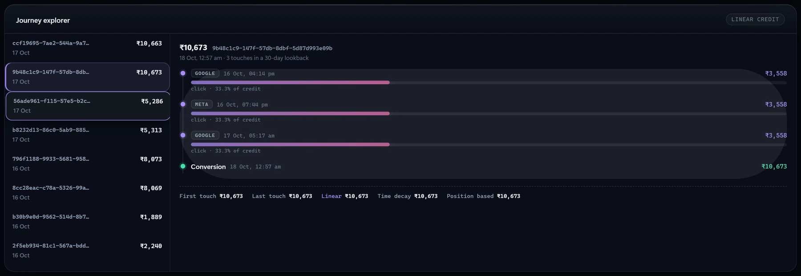

# ChannelTruth

**Multi-touch attribution and ROAS for cross-channel ad spend.**

Every ad platform reports the conversions it claims. Add those reports together and a
₹7,24,491 revenue month becomes ₹10,00,000+ of "attributed" revenue — the same order counted
three times. The marketing team then moves budget based on numbers that cannot all be true.

ChannelTruth is a neutral referee. It ingests touchpoints, conversions and daily channel spend,
builds each customer journey once, and attributes revenue under **five models** so the
disagreement between them is visible instead of hidden inside a vendor dashboard.

[](https://github.com/het12779-ui/channeltruth/actions/workflows/ci.yml)


---

## The dashboard

The first screen is built to start an argument, because that is the product.



**Channel credit** ranks channels under the selected model; **model comparison**
puts all five models side by side over the same journeys, with the delta against
last-touch (the number every ad platform reports by default) in the last column.
Google reads **1.57× under last-touch and 0.55× under first-touch** — the same
spend, two opposite recommendations. That disagreement is not a bug to be
smoothed away; it is the honest output.



**Journey explorer.** Pick a conversion and see every touch, its timestamp, the
shifted credit split, and the per-model totals along the bottom. When a marketer
asks "why did email get ₹10,673", this is the answer, not a black box.

Design notes:

- the heat intensity of each matrix cell is the channel's share under that model,
  so the visual weight matches the number rather than fighting it;
- motion is ambient and entrance-only; `prefers-reduced-motion` disables it;
- Vue 3 via ES modules, one stylesheet, no build step, no CDN — `make run` and
  the dashboard is live.

---

## Why this belongs in an Advertising Cloud

| DeltaX Associate Product Engineer requirement | Where it shows up here |
|---|---|
| Full-stack ownership | FastAPI + SQLAlchemy backend, Vue 3 explorer, one command to run |
| Multi-tenant data | `account_id` on every fact table, API-key tenancy, cross-tenant journey tests |
| SQL beyond CRUD | Composite-index journey lookup, chunked `IN` for SQL Server's 2,100-param limit, aggregation for ROAS |
| REST APIs | Versioned `/api/v1`, batch ingest, idempotency and restatement semantics |
| Analytical correctness | Largest-remainder cent allocation, conservation invariants tested per model |
| BDD | `pytest-bdd` scenarios written in marketer language over the pure engine |
| CI/CD | GitHub Actions matrix + live smoke test |
| ELK-style observability | Structured JSON request logs with `request_id` / `tenant_id`, Prometheus metrics |
| Advertising domain | Cross-channel credit, lookback windows, ROAS, unattributed conversions |
| MS SQL Server | Dialect-neutral ORM; `migrations/001_init.sql` is the SQL Server 2022 schema |

C# is not part of this repository — it is deliberately a Python/Vue slice. The SQL Server DDL
is included so the schema reasoning is reviewable.

---

## What it does

- **Five models** — first touch, last touch, linear, time decay (configurable half-life) and
  position based (40 / 20 / 40).
- **Journey assembly** — for each conversion, every touch by the same visitor inside a
  configurable lookback window, ordered deterministically (timestamp, then id).
- **Exact money** — a conversion's revenue is split with the largest remainder method, so the
  parts always sum back to the original amount. No lost or invented paise.
- **ROAS per channel** — attributed revenue ÷ media spend, with channels that spent money but
  earned no credit still listed (that is usually the interesting row).
- **Model comparison on one dataset** — the journeys are loaded once and scored five times;
  comparing models over different datasets is how meaningless attribution decks happen.
- **Journey explainability** — per-touch credit for every model, so a marketer can see *why*
  last-touch gives Google 4× what first-touch does.
- **Unattributed revenue** — conversions with no in-window touch are reported as unattributed
  rather than silently assigned to `direct`.

---

## Architecture

```
   platform touchpoints ─┐
   conversions ──────────┼──▶ POST /api/v1/{touchpoints,conversions,spend}
   daily channel spend ──┘        idempotent on event_uid
                                  spend upserts on (channel, day)
                                            │
                                            ▼
                        ┌───────────────────────────────────────┐
                        │ touchpoints · conversions · channel_spend │
                        └───────────────────┬───────────────────┘
                                            │  2 queries (chunked IN for visitors)
                                            ▼
                        ┌───────────────────────────────────────┐
                        │ services/journeys.py → Journey[]        │
                        │   (conversion + in-window touches)      │
                        └───────────────────┬───────────────────┘
                                            ▼
                        ┌───────────────────────────────────────┐
                        │ services/attribution.py (pure)          │
                        │   weights → allocate_cents → credits    │
                        └───────────────────┬───────────────────┘
                                            ▼
        GET /attribution · /attribution/compare · /attribution/journeys/{uid}
                                            │
                                            ▼
                        Vue 3 explorer (same origin, no CORS)
```

The attribution maths has no database, no clock and no HTTP in it. That is why the allocation
edge cases are cheap to test and why the same functions serve the report, the comparison and
the per-touch explanation.

---

## Quickstart

### Windows (PowerShell)

```powershell
cd channeltruth
python -m venv .venv
.venv\Scripts\python.exe -m pip install -r requirements-dev.txt
.venv\Scripts\python.exe -m uvicorn channeltruth.main:app --app-dir src --port 8020
```

### macOS / Linux

```bash
cd channeltruth
make install
make run          # http://127.0.0.1:8020
```

### Docker

```bash
docker build -t channeltruth:1.0.0 .
docker run --rm -p 8080:8080 channeltruth:1.0.0
```

Open <http://127.0.0.1:8020>. On first boot the database seeds itself with 31 days of spend,
~280 visitors and ~115 conversions across Google, Meta, display, email and direct.

| Account | API key | Notes |
|---|---|---|
| Meridian Home | `ct_demo_meridian_key` | Full journey history |
| Trailhead Outdoors | `ct_demo_trailhead_key` | Isolated second tenant |

> Demo mode lets the dashboard name a tenant with `X-Account-Id` so no secret ships to the
> browser. Disabled with `CHANNELTRUTH_DEMO=0`; there is a test for that.

---

## API

| Method | Path | Purpose |
|---|---|---|
| `GET` | `/healthz` · `/readyz` · `/metrics` | Liveness, readiness, Prometheus |
| `POST` | `/api/v1/touchpoints` · `/touchpoints/batch` | Idempotent touch ingest |
| `POST` | `/api/v1/conversions` · `/conversions/batch` | Idempotent conversion ingest |
| `POST` | `/api/v1/spend` · `/spend/batch` | Upsert daily channel spend |
| `GET` | `/api/v1/attribution` | Report for one model (`?model=&from=&to=`) |
| `GET` | `/api/v1/attribution/compare` | All five models over the same journeys |
| `GET` | `/api/v1/attribution/journeys/recent` | Recent conversions for the explorer |
| `GET` | `/api/v1/attribution/journeys/{uid}` | Per-touch credit for every model |

### Walkthrough

```bash
# a two-touch journey: discovery on display, conversion via search
curl -s -X POST http://127.0.0.1:8020/api/v1/touchpoints/batch \
  -H "X-API-Key: ct_demo_meridian_key" -H "Content-Type: application/json" \
  -d '{"touchpoints":[
        {"event_uid":"t-1","visitor_id":"v-42","channel":"display",
         "occurred_at":"2026-10-01T10:00:00Z"},
        {"event_uid":"t-2","visitor_id":"v-42","channel":"google",
         "occurred_at":"2026-10-09T10:00:00Z"}]}'

curl -s -X POST http://127.0.0.1:8020/api/v1/conversions \
  -H "X-API-Key: ct_demo_meridian_key" -H "Content-Type: application/json" \
  -d '{"event_uid":"c-42","visitor_id":"v-42",
       "revenue_cents":100000,"occurred_at":"2026-10-09T12:00:00Z"}'

curl -s "http://127.0.0.1:8020/api/v1/attribution?model=last_touch&from=2026-10-09&to=2026-10-09" \
  -H "X-API-Key: ct_demo_meridian_key"
```

Money is always integer minor units (`*_cents`). Timestamps are stored naive UTC and returned
with an explicit offset.

---

## The models

For a journey with touches `t₁…tₙ` and conversion time `T`:

| Model | Weight per touch | What it rewards |
|---|---|---|
| `first_touch` | `1` for `t₁`, else `0` | Discovery, brand and top-of-funnel |
| `last_touch` | `1` for `tₙ`, else `0` | The channel that closed (what most platforms report) |
| `linear` | `1` for every touch | A neutral baseline |
| `time_decay` | `0.5 ^ (age_days / half_life)` | Recency; 7-day half-life by default |
| `position_based` | `0.4 / 0.2·(n−2)⁻¹ / 0.4` | Both the opener and the closer |

### Two invariants the code guarantees

**1. Money is conserved.** Every model distributes exactly the revenue it was given:

```
sum(revenue_by_model) == sum(conversion revenue)     for all five models
```

**2. A split never loses a paisa.** `allocate_cents` uses the largest remainder method:
floor every exact share, then hand out the leftover paise by descending fractional remainder
(ties broken by index for reproducibility). ₹1,000 split three ways becomes
`33334 / 33333 / 33333` — not `33333 / 33333 / 33333` with a paisa evaporating.

Both are asserted directly in the suite, including a 54-case parameter sweep over awkward
totals (1, 3, 7, 99, 101, 999, 12,345, 1,000,001 cents) and touch counts (1–7).

---

## Measured results

### What the demo data shows

115 conversions, ₹7,24,491 attributed, ₹5,64,290 tracked spend, blended ROAS 1.28×.

| Channel | First touch | Last touch | Linear | Spend | ROAS first / last / linear |
|---|---:|---:|---:|---:|---|
| google | ₹1,49,222 | ₹4,27,228 | ₹2,77,426 | ₹2,71,663 | 0.55× / 1.57× / 1.02× |
| display | ₹2,03,784 | ₹68,554 | ₹1,21,814 | ₹89,388 | 2.28× / 0.77× / 1.36× |
| meta | ₹1,98,628 | ₹56,399 | ₹1,34,972 | ₹1,86,804 | 1.06× / 0.30× / 0.72× |
| direct | ₹1,19,673 | ₹1,42,598 | ₹1,39,361 | ₹0 | — |
| email | ₹53,185 | ₹29,712 | ₹50,918 | ₹16,434 | 3.24× / 1.81× / 3.10× |

The swing is the point: **Google looks like the best channel under last-touch (1.57×) and a
loss-making one under first-touch (0.55×)**. Display flips the other way. Meta is unprofitable
under linear (0.72×) but looks fine if you only read first-touch. A dashboard that shows one
number is not telling the marketer anything stable.

Every model's total is identical (₹7,24,491) — the difference is purely where the credit lands.

### Endpoint performance

`GET /api/v1/attribution/compare` — journey assembly, all five models, serialisation and JSON —
on SQLite, Python 3.12, single uvicorn worker, Windows 11 laptop. Reproduce with
`python scripts/bench_compare.py`.

| Journeys | Touches | p50 | p95 | max | Payload |
|---:|---:|---:|---:|---:|---:|
| 100 | 300 | 15.2 ms | 17.0 ms | 19.0 ms | 1 KB |
| 1,000 | 3,000 | 74.1 ms | 102.0 ms | 110.4 ms | 1 KB |
| 5,000 | 15,000 | 368.5 ms | 420.3 ms | 427.3 ms | 1 KB |

Two things worth noting:

- The payload stays ~1 KB because the report is **channel-level**, not journey-level. Response
  size scales with channels, not conversions — which is what makes this endpoint safe to poll.
- Latency still scales with journeys: it is `O(journeys × touches × models)`. At 5k journeys the
  comparison takes ~0.37 s, so the next step is materialising per-journey weights once and
  scoring all five models in a single pass (and, beyond that, pre-aggregating into a daily
  attribution table). For a typical pod-sized account (hundreds of conversions/day), the
  current implementation is well inside an interactive budget.

---

## Testing

```
tests/test_attribution_math.py   22 functions (78 cases with parametrisation)
tests/test_api.py                15  ingest, reports, comparison, journey detail
tests/test_tenant_isolation.py    8  cross-tenant reads, shared visitor ids, auth modes
tests/test_attribution_bdd.py     4  BDD scenarios (pytest-bdd)
                                 ──
                                102  passing
```

```bash
python -m pytest -q             # 102 passed
python -m pytest -q -k bdd      # behaviour scenarios only
```

The BDD layer speaks marketer, not HTTP:

```gherkin
Scenario: Linear splits the revenue and keeps every paisa
  Given a three-step journey from "display" to "meta" to "google" worth 100000 cents
  When I attribute it with the "linear" model
  Then "display" is credited 33334 cents
  And "meta" is credited 33333 cents
  And "google" is credited 33333 cents
  And the credited total is 100000 cents
```

Tenancy is treated as a security property:

- cross-tenant journey lookups return `404`, never `403`;
- the same `visitor_id` in two tenants produces two unrelated journeys (tested);
- every business table must carry `account_id` — enforced by a schema-level test so a future
  table cannot silently forget it;
- demo-mode bypass is refused when `CHANNELTRUTH_DEMO=0` (tested).

---

## Design decisions and trade-offs

| Decision | Why | Cost |
|---|---|---|
| Integer cents + largest remainder | Attribution that doesn't reconcile is worse than none | Slightly uneven splits (one channel gets the extra paisa) |
| Attribution computed on request | Model changes never rewrite facts; five models from one dataset | Recomputed per request; needs materialisation at scale |
| Journey loaded once per comparison | Prevents "each model over a different dataset" nonsense | All five models must share lookback and half-life |
| Dedupe at the DB, upsert for spend | At-least-once delivery and platform restatements are the norm | Ingest must handle `IntegrityError` (SAVEPOINT per row) |
| `404` for cross-tenant ids | Never confirm existence across tenants | Slightly harder support debugging |
| Direct traffic modelled as a channel | Hiding it is how platforms over-claim; showing it invites debate | Direct has no spend, so its ROAS is undefined |
| Unattributed bucket kept | A conversion with no touch is a measurement gap, not free credit | Totals need one extra field to explain |
| Naive UTC storage | `datetime2` has no offset; aware/naive mixing causes off-by-one-day bugs | Conversion at the edges is explicit |

---

## Production path

1. **SQL Server** — set `DATABASE_URL` to `mssql+pyodbc://…` and apply
   `migrations/001_init.sql`. The read model is portable SQL.
2. **Scale** — materialise a daily `attribution_daily` aggregate keyed by
   `(account, day, channel, model)`; the fact tables stay append-only. Partition
   `touchpoints` by month and add a clustered columnstore for the scans.
3. **Identity** — the current model trusts a supplied `visitor_id`. Real deployments need a
   deterministic identity graph (hashed email, device graph) before cross-device claims hold.
4. **View-through** — impressions currently earn credit like clicks. A production model needs
   separate view-through windows (typically 1 day for display, 7 for video).
5. **Alerts** — "Meta ROAS fell below 1.0 for three days" is the natural next feature, and it
   composes directly with PaceGuard's guardrail pattern.

### Not implemented (stated plainly)

- No cross-device identity resolution; `visitor_id` is taken as given.
- No per-channel lookback or per-channel view-through windows.
- No incremental/lift modelling or media-mix modelling — this is attribution, not experimentation.
- Single currency in the demo seed; the schema stores cents without a currency column.
- The dashboard is a zero-build Vue app (vendored runtime) for one-command review; production
  would be a Vite SPA with the same components.

---

## Layout

```
channeltruth/
├── src/channeltruth/
│   ├── api/            ingest, attribution, system routers
│   ├── services/       attribution.py (pure maths), journeys.py (assembly)
│   ├── models.py       touchpoints, conversions, channel_spend
│   ├── schemas.py      request/response contracts
│   ├── tenant.py       API-key → account, demo-mode fallback
│   └── seed.py         deterministic cross-channel journeys
├── tests/              102 tests incl. features/attribution.feature
├── web/                Vue 3 attribution explorer (no build step)
├── migrations/         SQL Server 2022 DDL
├── scripts/            bench_compare.py
└── Dockerfile · Makefile · .github/workflows/ci.yml
```

Built by [Het Patel](https://github.com/het12779-ui) · MIT licensed.
